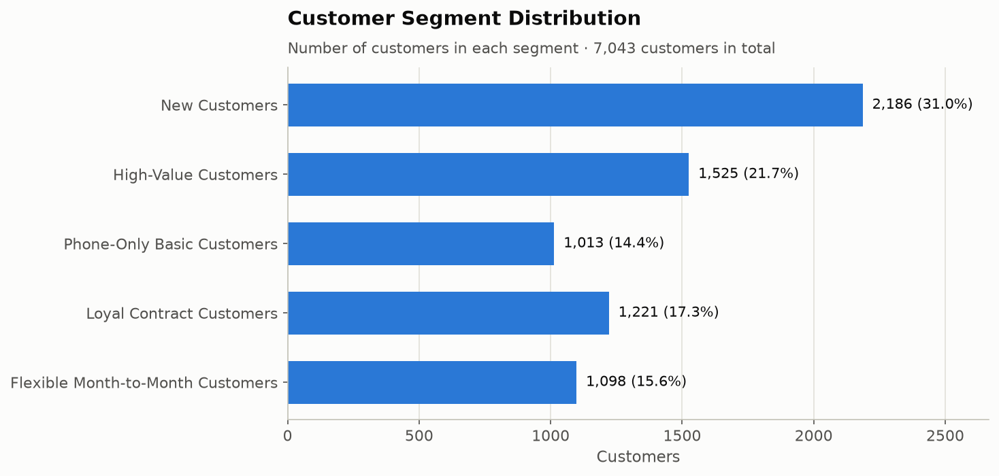
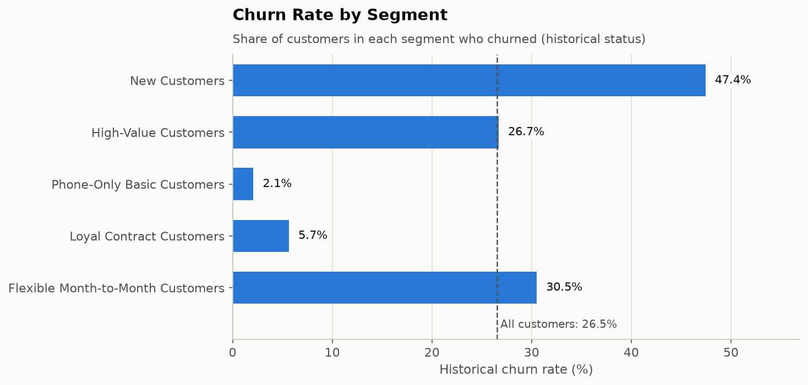
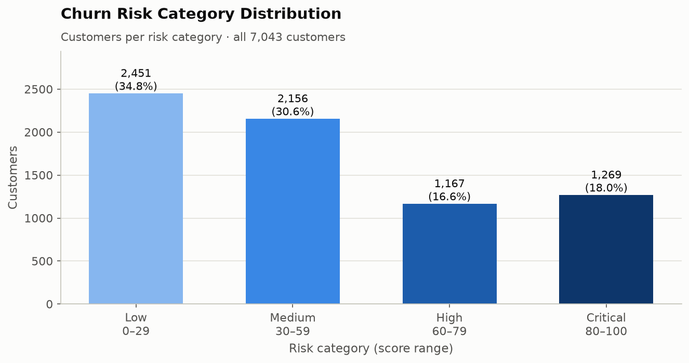
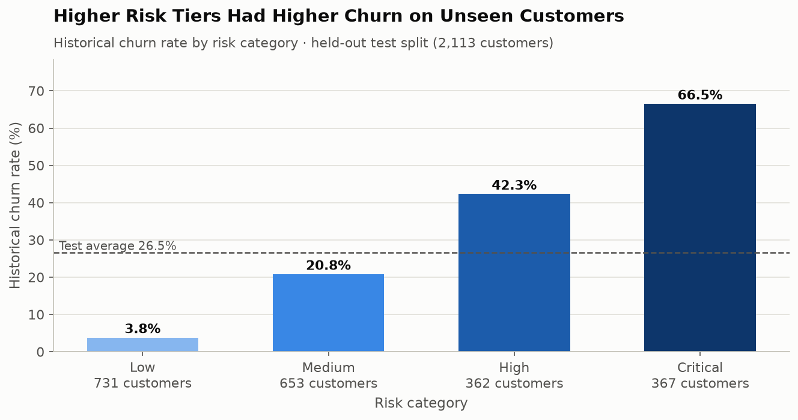
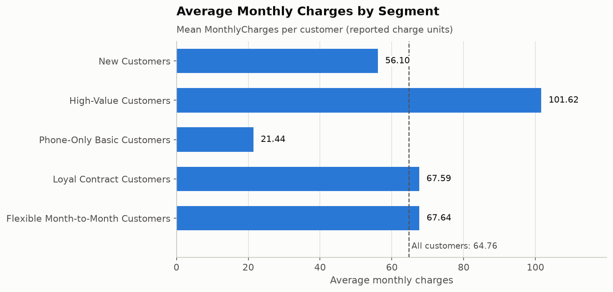
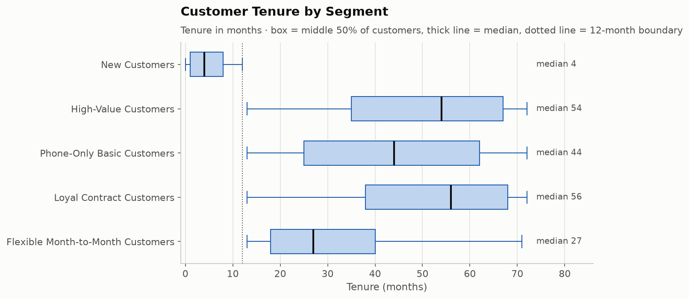
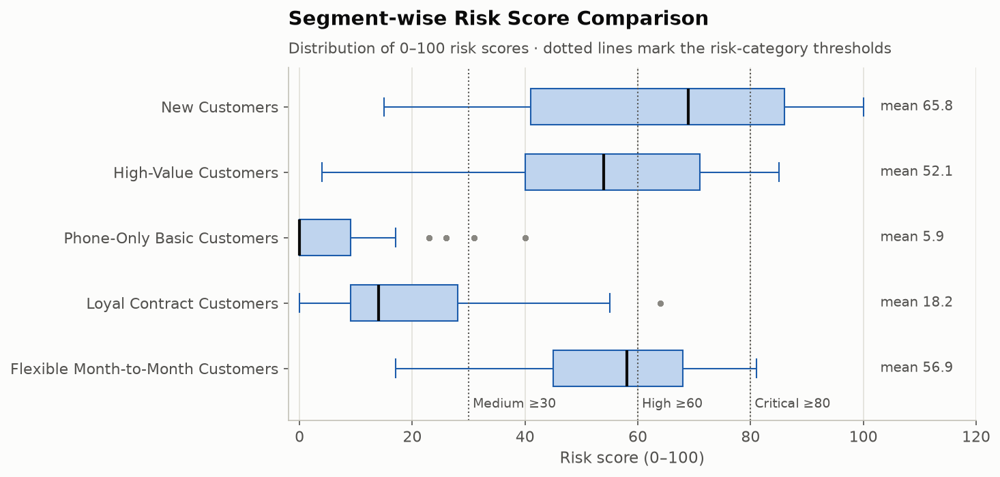

# Customer Churn Analysis – Data Quality Audit and Exploratory Data Analysis

> **Dataset substitution notice:** EdVyro resource files were unavailable during this project. The analysis therefore uses the public IBM Telco Customer Churn sample as an alternative. It is **not** the official EdVyro-provided dataset, and no claim of compliance with unavailable EdVyro-specific instructions is made.

An end-to-end, beginner-friendly customer churn audit and EDA project. It includes the unmodified raw data, a cleaned CSV, an executed analysis notebook, a generated data-quality report, chart artifacts, and an interactive Streamlit dashboard.

**Task 04 extension:** the project now also includes an explainable [customer segmentation, churn-risk scoring and recommendation model](#task-04-customer-segmentation-and-recommendation-model). It has an executed notebook, segment and risk-score tables, a recommendation memo and an edge-case validation report.

## Dataset source and verification

- IBM repository: [IBM/telco-customer-churn-on-icp4d](https://github.com/IBM/telco-customer-churn-on-icp4d)
- Direct CSV: [Telco-Customer-Churn.csv](https://raw.githubusercontent.com/IBM/telco-customer-churn-on-icp4d/master/data/Telco-Customer-Churn.csv)
- The GitHub repository describes its Telco customer churn dataset and includes the CSV at `data/Telco-Customer-Churn.csv`.
- Downloaded source SHA-256: `16320c9c1ec72448db59aa0a26a0b95401046bef5d02fd3aeb906448e3055e91`

The repository is archived/read-only. Check the source terms and data provenance before reusing it beyond this educational project.

## Objectives

- Inspect the dataset's dimensions, schema, missingness, duplicate records, unique values, invalid values, and potential statistical outliers.
- Preserve the raw download and document every cleaning decision.
- Validate the cleaned data and export a reproducible CSV.
- Describe churn overall and across contract, payment, and tenure segments.
- Examine monthly charges and numerical relationships without making causal claims.
- Provide a filterable dashboard for customer segments and an auditable written report.

## Project structure

```text
customer-churn-analysis/
├── data/
│   ├── raw/Telco-Customer-Churn.csv
│   └── processed/customer_churn_cleaned.csv
├── notebooks/
│   ├── customer_churn_analysis.ipynb
│   └── 04_segmentation_recommendation.ipynb      # Task 04
├── reports/
│   ├── data_quality_report.md
│   ├── recommendation_memo.md                     # Task 04
│   └── edge_case_validation.md                    # Task 04
├── outputs/                                       # Task 04
│   ├── customer_segments.csv
│   ├── segment_summary.csv
│   ├── customer_risk_scores.csv
│   ├── risk_scoring_weights.csv
│   ├── priority_retention_list.csv
│   ├── task04_metrics.json
│   └── visuals/*.png
├── dashboard/app.py
├── visuals/
│   ├── churn_distribution_notion_agent_chart.html
│   ├── contract_churn_notion_agent_chart.html
│   ├── segment_analysis_notion_agent_chart.html
│   └── chart JSON specifications
├── scripts/
│   ├── analyze_customer_churn.py
│   ├── segmentation_model.py                      # Task 04
│   └── validate_edge_cases.py                     # Task 04
├── analysis_evidence.json
├── requirements.txt
└── .gitignore
```

## Results from the downloaded sample

These values are calculated from the included source CSV and recorded in `analysis_evidence.json`:

- **7,043** customer records across **21** source columns.
- **1,869** churned customers; observed churn rate **26.54%**.
- **0** exact duplicate records and **0** repeated customer IDs.
- **11** blank `TotalCharges` values; all 11 belong to zero-tenure rows and are set to `0.0` under the documented cumulative-charge assumption.
- Month-to-month contracts have the highest observed churn rate (**42.71%**, 1,655 of 3,875); two-year contracts have the lowest (**2.83%**, 48 of 1,695).
- Electronic-check payment has the highest observed payment-method churn rate (**45.29%**, 1,071 of 2,365).
- All implemented data validation checks passed.

These are descriptive results for the alternative sample—not estimates for EdVyro or a current telecom provider.

## Methodology

1. Preserve the source CSV in `data/raw/`.
2. Trim string whitespace and interpret blank strings as missing.
3. Convert `TotalCharges` from numeric text to a numeric type.
4. Impute the 11 blank `TotalCharges` entries to zero only after checking that each row has zero tenure. This is a transparent domain assumption, not a value recovered from the source.
5. Do not delete any customer: the source has no exact duplicate rows or duplicate customer IDs, and IQR outliers are plausible customer observations.
6. Check field domains, missing values, key uniqueness, nonnegative charges/tenure, churn labels, and a direct-filter cross-check of the churn count.
7. Use descriptive summaries and within-segment churn rates; avoid causal interpretations.

`scripts/analyze_customer_churn.py` regenerates the cleaned CSV, evidence JSON, report, and chart JSON specifications from the included raw CSV:

```bash
python scripts/analyze_customer_churn.py
```

The generated HTML chart artifacts are checked in under `visuals/`. They were built from the included specifications; regenerating those particular HTML files requires the chart-builder environment used to create them.

## Task 04: Customer Segmentation and Recommendation Model

**Deliverables:** [Analysis notebook](notebooks/04_segmentation_recommendation.ipynb) · [Segment table](outputs/segment_summary.csv) · [Recommendation memo](reports/recommendation_memo.md) · [Edge case validation](reports/edge_case_validation.md)

### Business objective

Move from describing churn to an **explainable prioritisation model**: decide which customers the retention team should contact first, explain why each customer was flagged, and match each customer to a suitable retention action.

The work keeps three things separate:

- **Historical churn status:** the dataset's `Churn` column.
- **Rule-based churn-risk score:** transparent points that never use `Churn` as an input. It is not a trained predictive model.
- **Benchmark logistic regression:** used only as a yardstick for the score, and never exported.

### Segmentation methodology

Five mutually exclusive segments are assigned by ordered business rules (first match wins). Thresholds come from the contract calendar and the charge distribution, never from churn. K-Means was evaluated (best silhouette 0.403 at k = 3, which means groups overlap) and was not adopted because it adds no clear separation and is harder to explain.

| Segment | Rule | Customers | Share | Avg tenure | Avg monthly charges | Historical churn | Avg risk score |
| --- | --- | ---: | ---: | ---: | ---: | ---: | ---: |
| New Customers | Tenure ≤ 12 months | 2,186 | 31.0% | 4.7 | 56.10 | 47.4% | 65.8 |
| High-Value Customers | Tenure > 12 and monthly charges ≥ 90 | 1,525 | 21.7% | 50.3 | 101.62 | 26.7% | 52.1 |
| Phone-Only Basic Customers | Tenure > 12 and no internet service | 1,013 | 14.4% | 43.7 | 21.44 | 2.1% | 5.9 |
| Loyal Contract Customers | Tenure > 12 on a one- or two-year contract | 1,221 | 17.3% | 51.8 | 67.59 | 5.7% | 18.2 |
| Flexible Month-to-Month Customers | Tenure > 12 on a month-to-month contract | 1,098 | 15.6% | 30.4 | 67.64 | 30.5% | 56.9 |

### Churn-risk scoring

The score uses eight yes/no indicators built from account and service fields. Demographics are excluded for fairness.

1. Customers are split 70/30 (stratified, seed 42).
2. Each indicator's churn-rate lift is measured on the **training split only**.
3. The indicators share 100 points in proportion to their lift.
4. The score is normalised to 0–100. Categories: **Low 0–29 · Medium 30–59 · High 60–79 · Critical 80–100**.

| Indicator | Points | | Indicator | Points |
| --- | ---: | --- | --- | ---: |
| Month-to-month contract | 17 | | No Tech Support (internet customers) | 14 |
| Tenure ≤ 12 months | 15 | | Fiber optic internet | 13 |
| Electronic check payment | 14 | | Paperless billing | 9 |
| No Online Security (internet customers) | 14 | | Monthly charges ≥ 90 | 4 |

**Validation on the 2,113 held-out customers:**
- ROC AUC was **0.826** (training: 0.836; logistic-regression benchmark: 0.831).
- Historical churn rose from **3.8% (Low) → 20.8% (Medium) → 42.3% (High) → 66.5% (Critical)**.
- The High and Critical tiers held 34.5% of test customers but captured **70.8% of churners**.

### Recommendation engine

The **risk tier** sets urgency:
- P1 Critical: personal retention call.
- P2 High: personalised offer.
- P3 Medium: engagement campaign.
- P4 Low: loyalty and referral.

The **segment** sets content:
- New Customers: onboarding.
- High-Value Customers: priority support and plan-fit review.
- Flexible Month-to-Month Customers: contract options and add-on bundle.
- Loyal Contract Customers: renewal management.
- Phone-Only Basic Customers: light-touch maintenance.

Every customer gets a `retention_priority` and a `recommended_action`. Active High/Critical customers are ranked in `outputs/priority_retention_list.csv`.

### Key insights

- **1,090 active customers** are High or Critical, and their monthly charges total **83,087.30**, or 26.2% of active monthly charges. This is revenue exposure, not projected savings.
- **First-year customers make up 49.4% of that list**, and 64.5% of all New Customers score High or Critical.
- High-Value customers on month-to-month terms churned at **44.0%**, versus **13.9%** on one- or two-year contracts. This is an association, not a proven effect.
- 90% of priority customers have internet without Online Security or Tech Support, which makes protective add-on bundles a concrete offer to test.
- Phone-Only Basic (2.1% churn) and Loyal Contract (5.7%) customers make up 31.7% of the base and need only low-cost programmes.

### Visualizations

| | |
| --- | --- |
|  |  |
|  |  |
|  |  |
|  | |

### Generated outputs

| File | Contents |
| --- | --- |
| [`outputs/customer_segments.csv`](outputs/customer_segments.csv) | One row per customer: segment, risk score and category, priority, recommended action, key account features, historical churn status |
| [`outputs/segment_summary.csv`](outputs/segment_summary.csv) | One row per segment: size, share, averages, churn rate, average risk, characteristics, interpretation, recommended action |
| [`outputs/customer_risk_scores.csv`](outputs/customer_risk_scores.csv) | One row per customer: all eight 0/1 indicators, raw points, 0–100 score, risk category |
| [`outputs/risk_scoring_weights.csv`](outputs/risk_scoring_weights.csv) | Indicator definitions, training-split lift and points |
| [`outputs/priority_retention_list.csv`](outputs/priority_retention_list.csv) | Ranked active High/Critical customers with actions |
| [`outputs/task04_metrics.json`](outputs/task04_metrics.json) | Headline validation and summary numbers used in the memo |
| [`outputs/visuals/`](outputs/visuals/) | Seven PNG charts |

Customer-level files contain no demographic fields, only the dataset's anonymised `customerID`.

### Edge-case validation

`scripts/validate_edge_cases.py` runs 17 checks, and all 17 pass. They cover:
- missing and repeated IDs;
- missing numbers and categories;
- zero tenure;
- zero and extreme charges;
- unknown labels;
- empty inputs;
- insufficient information;
- score bounds and category boundaries;
- full-dataset invariants.

See [reports/edge_case_validation.md](reports/edge_case_validation.md).

### How to run Task 04

From the project root, with the virtual environment active and `pip install -r requirements.txt` done:

```bash
jupyter nbconvert --to notebook --execute --inplace notebooks/04_segmentation_recommendation.ipynb
```

The command regenerates every CSV and chart in `outputs/` plus `reports/edge_case_validation.md`. You can also open the notebook in Jupyter and choose *Run All*. To run the edge-case suite on its own:

```bash
python scripts/validate_edge_cases.py
```

The business rules live in [`scripts/segmentation_model.py`](scripts/segmentation_model.py), so the notebook, the validation script and any future dashboard share one implementation.

## Technologies

- Python, pandas, NumPy
- Jupyter Notebook
- Matplotlib and Seaborn (Task 04 charts in `outputs/visuals/`; the earlier chart artifacts are delivered as HTML)
- scikit-learn (Task 04: stratified split, ROC AUC, K-Means comparison and the logistic-regression benchmark)
- Streamlit
- Git and GitHub

## Installation and local run

Use Python 3.10 or later. From the project root:

```bash
python -m venv .venv
```

Activate the environment:

```bash
# Windows PowerShell
.venv\Scripts\Activate.ps1

# macOS/Linux
source .venv/bin/activate
```

Install dependencies and run the dashboard:

```bash
python -m pip install --upgrade pip
pip install -r requirements.txt
streamlit run dashboard/app.py
```

Open the local URL printed by Streamlit, usually `http://localhost:8501`.

To execute the notebook:

```bash
jupyter notebook notebooks/customer_churn_analysis.ipynb
```

The dashboard's sidebar filters update the customer KPIs, segment tables, customer preview, and descriptive business insights. The embedded HTML charts intentionally remain a full-sample reference so the chart context is stable while exploring filtered cohorts.

## GitHub publication

The project is published at [github.com/poorvansh4-ctrl/customer-churn-analysis](https://github.com/poorvansh4-ctrl/customer-churn-analysis). These steps document how it was first published:

1. Create a **public** repository on GitHub, for example `customer-churn-analysis`.
2. From this folder, initialize and commit the project:

   ```bash
   git init
   git add .
   git commit -m "Add customer churn data quality and EDA project"
   git branch -M main
   git remote add origin https://github.com/<your-username>/customer-churn-analysis.git
   git push -u origin main
   ```

3. Replace the repository placeholder below after verifying that the public repository is accessible.

**GitHub repository:** https://github.com/poorvansh4-ctrl/customer-churn-analysis

## Streamlit Community Cloud deployment

The dashboard is prepared for Streamlit Community Cloud, but it has **not** been deployed and no live URL is available yet.

1. Push the project to a public GitHub repository.
2. Sign in to [Streamlit Community Cloud](https://share.streamlit.io/).
3. Select **Create app**, choose the repository and branch (`main`), then set the main file path to `dashboard/app.py`.
4. Deploy, wait for the app to build, and test the public URL in a private/incognito browser window.
5. Add the live URL here only after it loads successfully.

**Live dashboard:** Not deployed yet.

## Screenshots

No deployed screenshot is included because the dashboard has not been published. After starting the app locally or deploying it, capture the full dashboard and add an image such as `visuals/dashboard_screenshot.png` here. The three source-backed HTML charts are already included in `visuals/` and are rendered by the dashboard.

## Limitations

- This is a substitute IBM dataset, not the unavailable EdVyro-provided resource.
- The CSV is a static sample with no extraction date or observation window.
- Churn-rate differences are descriptive and do not establish causation.
- The 11 zero-tenure `TotalCharges` blanks are imputed using a documented business assumption.
- IQR outliers are retained; statistical extremeness does not establish an error.
- Charge units are used as provided; this project does not infer a currency.
- Task 04's churn-risk score is a rule-based scorecard validated on a held-out split of the same snapshot. It is not a calibrated probability or a time-based forecast, and its recommended actions are hypotheses to test with a control group.